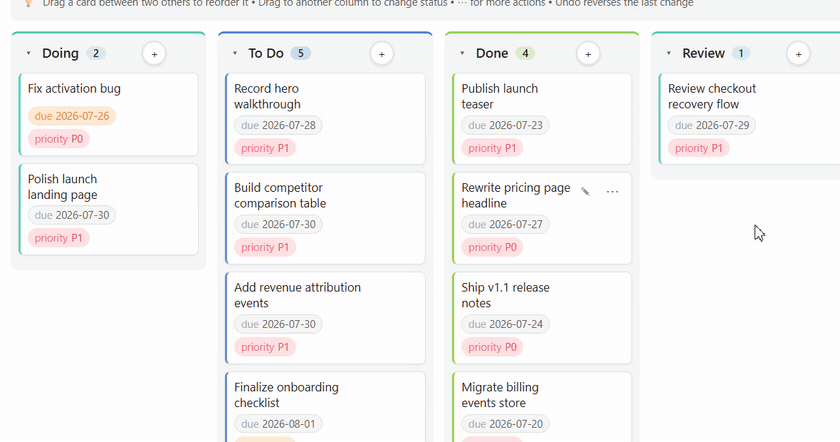
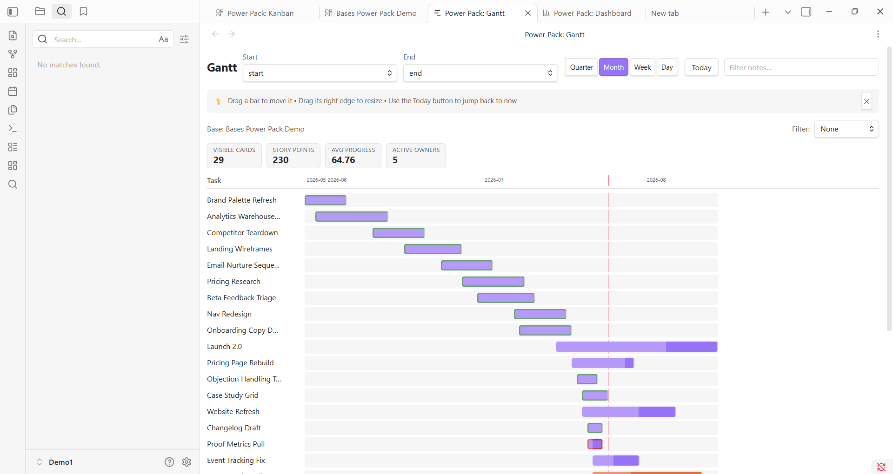
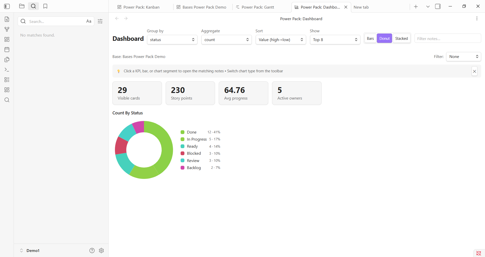
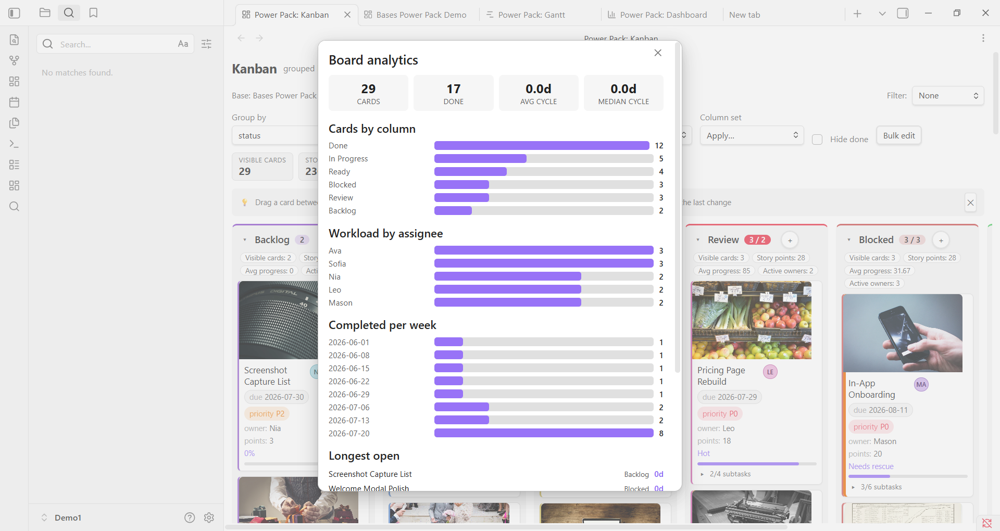
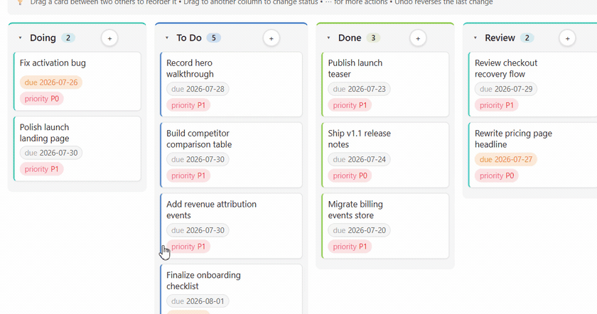

# Bases Power Pack

**Run real Kanban, Calendar, and Gantt boards that write straight back to your notes — no Dataview, no cloud, no account.**

Most Bases boards only *display* your notes. Bases Power Pack **writes the changes back**: drag a card, reschedule a date, resize a timeline bar — the note's frontmatter updates. Offline, in Markdown, with real planning views on top.



### Get Premium — **$29 one-time**, not a subscription

[**Unlock Bases Power Pack Premium →**](https://buymeacoffee.com/vaultspotlight/e/560211)

Paste the key → **unlocks instantly, offline.** No account, no server. The free Lite tier is a fully usable Kanban board — try it first.

<!-- SOCIAL PROOF SLOT — add 2–3 short, real user quotes (or a "used by N people" line) here the moment you have them.
     One real quote beats zero. Do NOT ship placeholder or invented quotes — an empty marker is better than fake proof.
     Example once real:
     > "Replaced three Dataview dashboards with one board that actually updates my notes." — @handle -->

## Lite (free) vs Premium

Most Bases boards only display. This one writes your changes back, stays offline, and adds the planning views Bases doesn't ship.

| Capability | Lite (free) | Premium |
| --- | :---: | :---: |
| Real Kanban board for Bases / frontmatter notes | ✅ | ✅ |
| Drag cards across columns and reorder them manually | ✅ | ✅ |
| Quick add, inline edit, bulk edit, search, export to Markdown | ✅ | ✅ |
| Swimlanes, WIP limits, multi-select moves, touch + keyboard moves | ✅ | ✅ |
| Calendar + Gantt planning views | — | ✅ |
| Dashboard + Pivot + Gallery + Feed views | — | ✅ |
| Formulas, roll-ups, saved filters, `.base`-driven workflows | — | ✅ |
| Move Rules automation, CSV export, color rules | — | ✅ |
| Board Analytics | — | ✅ |
| **Inline `key:: value` fields from note bodies** | — | ✅ |
| **Task rows: every `- [ ]` line, with writeback** | — | ✅ |
| **Link traversal + `file.inlinks` / `file.outlinks`** | — | ✅ |
| **FLATTEN: one row per list value** | — | ✅ |
| **Dataview query → `.base` converter** | — | ✅ |

[**Get Premium — $29 one-time →**](https://buymeacoffee.com/vaultspotlight/e/560211) · Paste the key → unlocks instantly, offline.

---

## Premium: turn your vault into a lightweight project system

**Turn your vault into a lightweight project system — without leaving Markdown.** You already keep the work in notes; Premium gives you the boards, timelines, and dashboards to actually run it. The views below are the proof:

- **Calendar & Gantt** — schedule and plan on a real timeline; drag events to reschedule, drag bars to move or resize work against milestones. Every change writes back to the note.
- **Dashboard & Analytics** — KPI cards, distribution charts, throughput, workload, and aging work — the management questions answered without exporting your vault into some other analytics tool.
- **Formulas, roll-ups & saved filters** — compute across your notes and save the views you reopen every day.
- **Automation** — Move Rules, rule-based color coding, and `.base`-driven workflows so the board maintains itself.
- **Pivot, Gallery & Feed** — cross-tabulate like a spreadsheet, browse as a visual grid, or read a reverse-chronological stream.



_Gantt turns your notes into a real timeline: drag bars to move work, resize them to change duration, and plan against milestones._



_Dashboard gives you KPI cards and visual distribution without exporting your vault into some other analytics toy._



_Analytics makes the board answer the obvious management questions: throughput, workload, bottlenecks, and what is aging badly._



_Move work cleanly from Review to Done without opening a note or babysitting frontmatter._

### Get Premium — $29 one-time

[**Unlock Bases Power Pack Premium →**](https://buymeacoffee.com/vaultspotlight/e/560211) · one-time, no subscription.

1. Purchase via [Buy Me a Coffee](https://buymeacoffee.com/vaultspotlight/e/560211) ($29 one-time).
2. Your license key is emailed to you **automatically, within seconds** — delivery is fully automated, no waiting.
3. **Paste the key → unlocks instantly, offline.** (Settings → Bases Power Pack → License.) No account, no always-on server, no mandatory cloud.

---

## All views at a glance

- **Kanban** — group work by a property like `status`, drag cards, reorder them, and edit metadata in place.
- **Calendar** — see work by day/week/month and drag events to reschedule them.
- **Gantt** — plan spans and milestones on a timeline; drag bars to move or resize them.
- **Outline** — turn parent/child notes into a real hierarchy with progress roll-ups.
- **Pivot** — cross-tabulate rows × columns like a lightweight spreadsheet.
- **Dashboard** — KPI cards and distribution charts over your current dataset.
- **Gallery** — visual card grid with cover images and metadata pills.
- **Feed** — reverse-chronological stream grouped by day, week, or month.
- **Analytics** — a premium board analytics modal for throughput, workload, bottlenecks, and aging work.

## Beyond Bases: the Dataview data Bases can't see (Premium)

Bases reads **frontmatter** and counts **whole files**. That is the wall every
Dataview vault hits when it tries to move: years of `due:: 2026-01-01` live in note
*bodies*, and most people's real unit of work is a `- [ ]` line, not a note.

Power Pack is a standalone plugin, not a registered Bases view, so it can read the
vault directly. Four switches close the gap — each off until you turn it on, because
each costs one pass over your notes:

| Switch | What it unlocks |
| --- | --- |
| **Inline fields** | `key:: value` written anywhere in a note body becomes a real property — queryable by every view, filter, formula, roll-up, and colour rule. Frontmatter wins when both define the same key. |
| **Row source → Tasks** | Every `- [ ]` checkbox becomes its own row, with its own due date, priority, and assignee. Tasks inherit their note's properties, so you can group every task in the vault by its project. **Dragging a task card writes back to the checkbox line**, not the note's frontmatter — including the Tasks-plugin emoji shorthand (📅 🛫 ⏳ ✅ ⏫), updated in place. |
| **Link traversal** | `project.status` reads the property off the note `project` links to. Adds `file.inlinks`, `file.outlinks`, `file.inlinkCount`, `file.outlinkCount`. |
| **Flatten property** | One row per value of a list property — a note with three assignees becomes three cards. Makes per-person boards and tag matrices possible at all. |

Task rows also expose `task.status`, `task.done`, `task.checked`, `task.text`,
`task.section`, `task.line`, and `task.tags`; note rows gain `file.taskCount`,
`file.openTaskCount`, and `file.doneTaskCount`. The expression engine gains
`hastag(file.tags, "project")`, which matches nested `#project/alpha` the way
Dataview's `FROM #project` does.

### Import a Dataview query

**Convert a Dataview query to a base (Premium)** takes a DQL query and writes a
`.base` file plus the matching view:

```
TABLE status, due AS "Deadline"
FROM #project AND -"Archive"
WHERE status != "done"
GROUP BY status
```

TABLE / LIST / TASK / CALENDAR, `FROM`, `WHERE`, `SORT`, `GROUP BY`, `FLATTEN`, and
`LIMIT` are all read. **Anything that can't be converted is reported and left out —
never guessed at.** A `WHERE` clause using a function with no equivalent is dropped
with a warning, and the warning is written into the generated `.base` as a comment,
because a filter that silently went missing is far worse than one that is visibly
absent.

## 2-minute quick start

1. Run **Open Kanban view (Lite)** from the command palette or click the ribbon icon.
2. Add a property like `status: To Do` to a few notes.
3. Drag a card to another column and watch the note update.
4. Click **⋯** on a card to edit, rename, move, or delete.
5. Use **search** to narrow the board and **Export** to copy it out.
6. If you want planning views, analytics, and database-style workflows, unlock Premium.

## Commands

Available from the command palette:

- **Open Kanban view (Lite)**
- **Open Calendar view (Premium)**
- **Open Gantt view (Premium)**
- **Open Outline view (Premium)**
- **Open Pivot view (Premium)**
- **Open Dashboard view (Premium)**
- **Open Gallery view (Premium)**
- **Open Feed view (Premium)**
- **Convert a Dataview query to a base (Premium)**
- **Undo last change**
- **Verify license key**

Premium view commands are always visible. If you have not unlocked Premium yet, they open an in-view unlock screen rather than quietly vanishing from the palette.

## Install

**Community plugins (recommended):** open **Settings → Community plugins**, search **Bases Power Pack**, and install it — one click, auto-updates.

### Manual install (for testing / sideload)

Copy these three files into:

```text
<your-vault>/.obsidian/plugins/bases-power-pack/
```

Files:

```text
main.js
manifest.json
styles.css
```

Then enable **Bases Power Pack** in **Settings → Community plugins**.

## Feedback and support

Bug reports, feature requests, and questions all go to the GitHub issue tracker. It is
the only place I track them, so an issue will always get further than a review comment.

- **[Report a bug](https://github.com/israerusan/bases-power-pack/issues/new?labels=bug)** — please include your Obsidian version, your operating system, and the steps that reproduce it.
- **[Request a feature](https://github.com/israerusan/bases-power-pack/issues/new?labels=enhancement)** — describe the workflow you are trying to make faster; that is more useful than a proposed solution.
- **[Browse open issues](https://github.com/israerusan/bases-power-pack/issues)** — worth a look first, in case it is already tracked.

## More plugins by the same author

Small, local-first Obsidian plugins that each do one job and keep your data in your vault.
All of them are in the community directory — search the name under
**Settings → Community plugins**.

**Search and views**

- [Vault Spotlight](https://github.com/israerusan/obsidian-vault-spotlight) — keyboard-first command center — fuzzy search, saved workflows, and result actions.

**Vault health**

- [Vault Triage](https://github.com/israerusan/vault-triage) — find stale, orphaned, unfinished, and metadata-broken notes, then work through them.
- [Attachment Audit](https://github.com/israerusan/attachment-audit) — find orphaned, duplicate, oversized, and misplaced attachments, then clean them up safely.
- [Patina](https://github.com/israerusan/patina) — score every note's staleness from edits, opens, and inbound links.
- [Vault Router](https://github.com/israerusan/vault-router) — move new notes out of Inbox with fast local routing rules.
- [FlowKit Health Dashboard](https://github.com/israerusan/flowkit-health-dashboard) — find which add-on is breaking your vault, and score every one installed.

**Writing and research**

- [Prose Lens](https://github.com/israerusan/prose-lens) — live writing feedback — passive voice, adverbs, hedges, cliches, and a reading grade.
- [Prior Art](https://github.com/israerusan/prior-art) — show similar existing notes while you write, and merge duplicates without losing links.
- [Standing Questions](https://github.com/israerusan/standing-questions) — track the open questions in your vault and surface new notes that may answer them.
- [Unwritten](https://github.com/israerusan/unwritten) — report the notes you never wrote — unexplained link pairs, stub hubs, unreasoned decisions.
- [Effort Index](https://github.com/israerusan/effort-index) — measure the editing time behind every note and resurface the expensive ones.

**Time and billing**

- [Task Calendar Bridge](https://github.com/israerusan/obsidian-task-calendar-bridge) — export dated Markdown tasks to standards-based ICS calendar files.
- [Invoice Forge](https://github.com/israerusan/obsidian-invoice-forge) — turn `#billable` notes into numbered invoices, so nothing is missed or billed twice.
- [Time Tracker and Invoicing](https://github.com/israerusan/time-tracker-invoicing) — track billable time against notes and projects, then invoice by client.

## Build

```bash
npm install
npm run build
npm run dev
npm run typecheck
npm test
```

`npm run build` produces `main.js` in the project root alongside `manifest.json` and `styles.css`.

## License

MIT for the source code. Premium feature access is governed by a signed license key.
